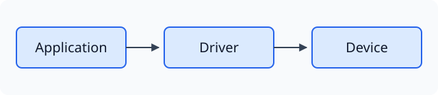
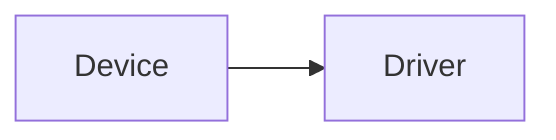
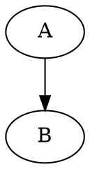
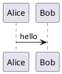

[Chinese](visual_code_blocks.md)

# Visual code blocks

Put a language name on the opening Markdown fence to select its bundled local renderer. No online drawing service is required. Native source is hidden while reading. Click a static diagram or choose Source in its hover menu to edit; moving into other content hides source again. Typora retains editing and undo. Hover reveals the existing More/Enlarge buttons; More opens source, copy, run and export actions without a permanent toolbar. Source in read-only previews toggles the original text. Copy Code copies the original text, and Run / Refresh recreates the diagram. SVG-producing renderers support enlargement and SVG export using a fresh snapshot at the time of the operation.

Static formats render automatically. `html` presents static HTML/CSS; use `html-live` for scripts. `html-live`, `javascript-live`, `jsx`, `tsx`, and `react` execute after Run / Refresh. Ordinary `js`, `javascript`, and `ts` remain non-executing examples. JavaScript demos receive a `root` container; React examples export a default component or define `App`.

Vega, Vega-Lite and ECharts accept JSON/JSON5 configuration; WaveDrom accepts WaveJSON/JSON5. React, react-dom/client and the JSX runtime are bundled; arbitrary npm dependencies are not installed automatically. External data, remote fonts/images, PlantUML includes and optional icon libraries are not downloaded. Use inline data and supported drawing primitives. SVG uses a static subset without scripts or foreignObject.

Native Mermaid, flow and sequence retain the host renderer. Mermaid previews try the host library first and fall back to bundled Mermaid on parse failure. Each library retains its own syntax/version limits. Search/link/Git readers use local KaTeX for inline and display math; native content and inactive split panes retain host math typesetting.

Interactive execution uses an opaque-origin iframe without Node, host DOM or file interfaces, with CSP restricting resource requests. An iframe is not a separate operating-system process and cannot guarantee termination of arbitrary infinite loops. Errors retain source; switching/closing disposes views. Native diagrams load by visibility; re-entering the visible area recreates interactive instances. Temporary interaction state is not saved to Markdown.

Copy the following examples into a note. The delivery covers on-screen rendering and individual SVG export. Whole-document Typora HTML/PDF export does not automatically replace every added fence with a diagram; export SVG and insert it as an image for sharing. Other platforms, full physical keyboard/wheel and prolonged stress validation remain separately documented.

Recent unchanged static SVG fences reappear from cache when scrolling back in the native document. Eviction, source edits, theme changes or manual refresh trigger rendering again.

## Inline size and enlarged viewing

Static diagrams and ordinary images use their natural size by default, scaling down proportionally only when wider than the text column. Their full height participates in document layout without an internal scrollbar. Small media is not stretched to fill the column; use hover enlargement for detail. SVG fences prefer a valid absolute width, falling back to viewBox width. For predictable portable SVG sizing, specify `width`, `height` and `viewBox` together. Bitmaps retain the existing screen-pixel/DPI contract; SVG uses vector layout units.

This describes default reading. Explicit image scale, Fit Width and native authored dimensions remain owned by existing settings/documents and are not rewritten during upgrade. Author-designed scrolling inside interactive pages remains intact; the enlarged viewer owns its independent zoom, pan and fit actions.

## Prefer portable syntax before tool-specific fences

Across Markdown projects, prefer forms natively supported by the target reader. Store SVG as a separate `.svg` with a relative image reference; use `mermaid` fences for suitable flow, sequence and structure diagrams. Use explicit language fences when keeping diagram source in a single file or when the target reader lacks an engine, and state: "Open this Markdown in TyporaCode to view the diagram." Keep raw SVG/HTML and drawing scripts out of prose. Changing only a language label does not convert between diagram syntaxes.

| Content | Preferred form | GitHub and ordinary browsers | TyporaCode |
| --- | --- | --- | --- |
| Static SVG | `.svg` file + `` | GitHub displays SVG images; HTML uses ``, and browsers can open SVG directly | Standard Markdown image with existing hover actions; edit the corresponding SVG file to change it |
| Single-file SVG source demonstration | `svg` fence | Do not assume the language label enables GitHub rendering; readers without an engine show code | Diagram while reading; click to edit the fence |
| Flow/structure/sequence diagrams | `mermaid` fence | Native GitHub support; ordinary HTML needs Mermaid or a static export | Existing native/shared-preview diagrams |
| Math | `$...$`, separate `$$...$$` | GitHub supports mathematical expressions; ordinary HTML needs typesetting or a static result | Existing native or KaTeX rendering |
| DOT, WaveDrom, Vega/Vega-Lite, ECharts, PlantUML, flow, sequence | Explicit language fence; include static SVG/PNG for portable publication | Do not assume GitHub or ordinary HTML provides the engine; retain the source boundary | Local rendering using the language examples below |
| HTML/CSS, HTML/JS, React | Fences for source; standalone HTML/built pages for web output | Browsers parse HTML/SVG; GitHub sanitizes Markdown HTML and does not execute arbitrary scripts or JSX | Static `html`; explicit interactive tags run on demand in isolation |

GitHub also natively supports `geojson`, `topojson` and ASCII `stl` fences, which are not in this tool's current diagram renderer list. Platform support does not establish tool implementation.

Opening a raw `.md` in an ordinary browser generally does not parse Markdown. Use a Markdown reader, GitHub's rendered view or generated HTML. Browser SVG support does not automatically render Markdown `svg` fences. HTML may use native `<svg>` or ``; prefer image references for documents also read on GitHub.

### A working SVG image reference

```markdown

```


The resource ships with both the repository and offline help. Copy the SVG alongside an example moved to another project, adjusting the path relative to its Markdown file. Keep one authoritative SVG resource rather than independently maintained copies of its contents.

### View tool-specific fences in TyporaCode

Install and restart TyporaCode normally, then open the `.md` containing the fenced diagram. Match the language labels in the examples below. Static diagrams render automatically; click one to edit its native fence source, then click other prose to collapse it. Hover for More, copy, refresh, enlarge and export. Interactive examples require Run first. For readers without the engine, export SVG from the hover menu and publish a standard image reference. Interactive content without SVG output needs a static screenshot or a standalone page, with source kept in an explicit fence.

References: [GitHub images and relative paths](https://docs.github.com/en/get-started/writing-on-github/getting-started-with-writing-and-formatting-on-github/basic-writing-and-formatting-syntax#images), [GitHub diagram syntax](https://docs.github.com/en/get-started/writing-on-github/working-with-advanced-formatting/creating-diagrams), [GitHub SVG limits](https://docs.github.com/en/repositories/working-with-files/using-files/working-with-non-code-files), and [SVG in browsers](https://developer.mozilla.org/en-US/docs/Learn_web_development/Core/Structuring_content/Including_vector_graphics_in_HTML). Checked 2026-11-03. GitHub notes that some Firefox contexts may not display SVG; provide a PNG fallback where needed. Static image support does not promise scripts or animation.

## Svg

```svg
<svg xmlns="http://www.w3.org/2000/svg" viewBox="0 0 240 80"><rect width="240" height="80" fill="lightblue"/><text x="10" y="40">Architecture SVG</text></svg>
```

## Html

```html
<style>.card{color:red;padding:12px}</style><div class="card">HTML composition</div>
```

## Mermaid



## Graphviz



## Wavedrom

```wavedrom
{signal:[{name:'clk',wave:'p.....'},{name:'data',wave:'x.345x',data:['A','B','C']}]}
```

## Vega

```vega
{"$schema":"https://vega.github.io/schema/vega/v6.json","width":200,"height":100,"data":[{"name":"table","values":[{"x":10,"y":20}]}],"marks":[{"type":"rect","from":{"data":"table"},"encode":{"enter":{"x":{"field":"x"},"y":{"field":"y"},"width":{"value":80},"height":{"value":40},"fill":{"value":"steelblue"}}}}]}
```

## Vega Lite

```vega-lite
{"data":{"values":[{"a":"A","b":3},{"a":"B","b":5}]},"mark":"bar","encoding":{"x":{"field":"a","type":"nominal"},"y":{"field":"b","type":"quantitative"}}}
```

## Echarts

```echarts
{"animation":false,"xAxis":{"data":["A","B"]},"yAxis":{},"series":[{"type":"bar","data":[2,3]}]}
```

## Plantuml



## Math

```math
E=mc^2
```

## Flow

```flow
st=>start: Start
e=>end: End
st->e
```

## Sequence

```sequence
Alice->Bob: hello
```

## React

```tsx
import React, {useState} from "react"; export default function App(){const [n,set_n]=useState(0);return <button onClick={()=>set_n(n+1)}>Count {n}</button>}
```

## Html Live

```html-live
<button id="count">0</button><script>document.getElementById("count").onclick=e=>e.target.textContent=Number(e.target.textContent)+1;</script>
```

## Javascript Live

```javascript-live
const button = document.createElement('button');
button.textContent = 'Click';
button.onclick = () => button.textContent = 'Done';
root.append(button);
```
