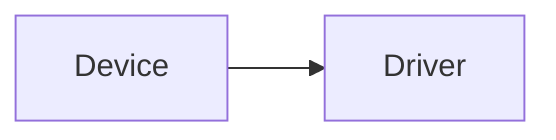
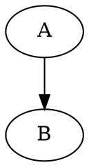
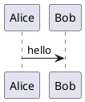

[Chinese](visual_code_blocks.md)

# Visual code blocks

Put a language name on the opening Markdown fence to select its bundled local renderer. No online drawing service is required. Native source is hidden while reading. Click a static diagram or choose Source in its hover menu to edit; moving into other content hides source again. Typora retains editing and undo. Hover reveals the existing More/Enlarge buttons; More opens source, copy, run and export actions without a permanent toolbar. Source in read-only previews toggles the original text. Copy Code copies the original text, and Run / Refresh recreates the diagram. SVG-producing renderers support enlargement and SVG export using a fresh snapshot at the time of the operation.

Static formats render automatically. `html` presents static HTML/CSS; use `html-live` for scripts. `html-live`, `javascript-live`, `jsx`, `tsx`, and `react` execute after Run / Refresh. Ordinary `js`, `javascript`, and `ts` remain non-executing examples. JavaScript demos receive a `root` container; React examples export a default component or define `App`.

Vega, Vega-Lite and ECharts accept JSON/JSON5 configuration; WaveDrom accepts WaveJSON/JSON5. React, react-dom/client and the JSX runtime are bundled; arbitrary npm dependencies are not installed automatically. External data, remote fonts/images, PlantUML includes and optional icon libraries are not downloaded. Use inline data and supported drawing primitives. SVG uses a static subset without scripts or foreignObject.

Native Mermaid, flow and sequence retain the host renderer. Mermaid previews try the host library first and fall back to bundled Mermaid on parse failure. Each library retains its own syntax/version limits. Search/link/Git readers use local KaTeX for inline and display math; native content and inactive split panes retain host math typesetting.

Interactive execution uses an opaque-origin iframe without Node, host DOM or file interfaces, with CSP restricting resource requests. An iframe is not a separate operating-system process and cannot guarantee termination of arbitrary infinite loops. Errors retain source; switching/closing disposes views. Native diagrams load by visibility; re-entering the visible area recreates interactive instances. Temporary interaction state is not saved to Markdown.

Copy the following examples into a note. The delivery covers on-screen rendering and individual SVG export. Whole-document Typora HTML/PDF export does not automatically replace every added fence with a diagram; export SVG and insert it as an image for sharing. Other platforms, full physical keyboard/wheel and prolonged stress validation remain separately documented.

## Svg

```svg
<svg xmlns="http://www.w3.org/2000/svg" viewBox="0 0 240 80"><rect width="240" height="80" fill="lightblue"/><text x="10" y="40">Architecture SVG</text></svg>
```

## Html

```html
<style>.card{color:red;padding:12px}</style><div class="card">HTML composition</div>
```

## Mermaid



## Graphviz



## Wavedrom

```wavedrom
{signal:[{name:'clk',wave:'p.....'},{name:'data',wave:'x.345x',data:['A','B','C']}]}
```

## Vega

```vega
{"$schema":"https://vega.github.io/schema/vega/v6.json","width":200,"height":100,"data":[{"name":"table","values":[{"x":10,"y":20}]}],"marks":[{"type":"rect","from":{"data":"table"},"encode":{"enter":{"x":{"field":"x"},"y":{"field":"y"},"width":{"value":80},"height":{"value":40},"fill":{"value":"steelblue"}}}}]}
```

## Vega Lite

```vega-lite
{"data":{"values":[{"a":"A","b":3},{"a":"B","b":5}]},"mark":"bar","encoding":{"x":{"field":"a","type":"nominal"},"y":{"field":"b","type":"quantitative"}}}
```

## Echarts

```echarts
{"animation":false,"xAxis":{"data":["A","B"]},"yAxis":{},"series":[{"type":"bar","data":[2,3]}]}
```

## Plantuml



## Math

```math
E=mc^2
```

## Flow

```flow
st=>start: Start
e=>end: End
st->e
```

## Sequence

```sequence
Alice->Bob: hello
```

## React

```tsx
import React, {useState} from "react"; export default function App(){const [n,set_n]=useState(0);return <button onClick={()=>set_n(n+1)}>Count {n}</button>}
```

## Html Live

```html-live
<button id="count">0</button><script>document.getElementById("count").onclick=e=>e.target.textContent=Number(e.target.textContent)+1;</script>
```

## Javascript Live

```javascript-live
const button = document.createElement('button');
button.textContent = 'Click';
button.onclick = () => button.textContent = 'Done';
root.append(button);
```
