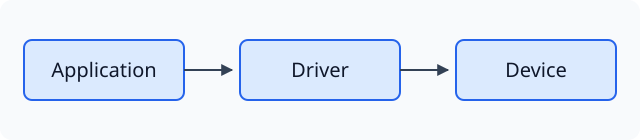
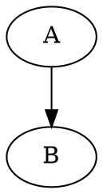
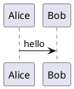

[English](visual_code_blocks.en.md)

# 图形代码块

在 Markdown 围栏第一行写下语言名，即可使用对应的本地渲染器。渲染库随安装包提供，不连接在线绘图服务。正文阅读时隐藏源码；点击静态图或悬停菜单中的“源码”进入原生编辑，移到其他正文后自动收起，原生编辑与撤销保持。悬停图形显示既有“更多 / 放大”按钮，“更多”展开源码、复制、运行与导出操作，不占用正文排版高度；只读预览的“源码”切换原文显示。“复制代码”复制原文，“运行 / 刷新”重建当前图形。能产生 SVG 的图形支持放大和导出 SVG，导出读取操作时的图形快照。

静态格式自动绘制。`html` 只呈现静态 HTML/CSS；需要脚本使用 `html-live`。`html-live`、`javascript-live`、`jsx`、`tsx`、`react` 点击“运行 / 刷新”后执行。普通 `js`、`javascript`、`ts` 仍是代码示例，不自动执行。JS 演示中 `root` 是绘图容器；React 导出默认组件或定义 `App`。

Vega、Vega-Lite、ECharts 使用 JSON/JSON5 配置；WaveDrom 使用 WaveJSON/JSON5。React 随包提供 React、react-dom/client 和 JSX runtime，不自动安装任意 npm 包。图表中外部数据、远程字体/图片、PlantUML 外部 include 或未随包附带的图标库不会自动下载；需要内嵌数据或已支持的图形元素。SVG 首批为静态图形，不执行脚本或 foreignObject。

正文原生 Mermaid、flow、sequence 保留宿主渲染器；Mermaid 只读预览优先复用宿主库，无法解析时尝试随包 Mermaid。每个库遵循其自己的语法和版本，并非所有第三方扩展均受支持。行内 `$...$` 和独立 `$$` 公式在搜索/链接/Git 阅读中由本地 KaTeX 呈现，原生正文与非活动分栏继续使用宿主数学能力。

交互运行在无同源权限的 iframe 内，不提供 Node、宿主 DOM 或文件接口，资源请求由 CSP 限制。iframe 不是独立操作系统进程，不能保证终止任意死循环。错误保留源码；切换/关闭清理渲染视图。长文中正文图形按可见性加载，重新进入可见区域会重建交互实例，交互临时状态不会写回 Markdown。

以下示例可直接复制到笔记中。屏幕呈现与逐图 SVG 导出是当前交付范围；Typora 整篇 HTML/PDF 导出不会自动把全部新增围栏替换为图形，分享时可先导出 SVG 再作为图片引用。其他平台和完整物理键盘/滚轮、长时压力验收见交付记录，不能用本文样例替代实测。

正文中的静态 SVG 围栏支持翻页缓存：未修改的近期图形返回时直接显示；缓存满、修改源码、切换主题或手动刷新时重新绘制。

## 正文尺寸与放大查看

静态图形和普通图片默认按自然尺寸显示，宽于正文时等比缩小到正文宽度；完整高度参与正文排版，不在图内增加滚动条。小图不会自动撑满正文，需要细节时使用悬停放大。SVG围栏优先取有效绝对宽度，只有viewBox时以其宽度为布局基准；跨平台需要确定尺寸的SVG建议同时写`width`、`height`和`viewBox`，避免不同读取方式采用不同默认尺寸。位图沿现有屏幕像素与DPI规则，SVG沿矢量布局单位。

此规则描述默认阅读。你明确设置过的图片比例、适应宽度或正文中的原生尺寸仍由原有设置/文档管理，不会因升级被重写。交互网页内部由作者设计的滚动区域保持自身行为；放大查看器拥有独立的缩放、拖动和适配操作。

## 先选通用写法，再用工具围栏

跨项目编写 Markdown 时优先采用目标平台原生支持的形式。SVG 推荐保存为独立 `.svg`，使用相对图片链接；流程、时序和结构图适合时使用 `mermaid` 围栏。需要保留单文件图形源码，或目标平台没有对应渲染器时，再使用明确的语言围栏，并注明“用 TyporaCode 打开此 Markdown 查看图形”。不要把裸 SVG/HTML、绘图脚本混入普通段落，也不要只改语言名就把一种图表语法当成另一种。

| 内容 | 推荐写法 | GitHub 与普通浏览器 | TyporaCode |
| --- | --- | --- | --- |
| SVG 静态图 | `.svg` 文件 + `` | GitHub可显示SVG图片；HTML使用``，浏览器也可直接打开SVG | Markdown图片正常显示，使用已有图片悬停操作；修改图形需编辑对应SVG文件 |
| 单文件SVG源码演示 | `svg` 围栏 | 不把围栏语言视为GitHub自动绘图；未接入渲染器时显示代码 | 阅读显示图，点图编辑当前围栏 |
| 流程/结构/时序图 | `mermaid` 围栏 | GitHub原生支持；普通HTML需要Mermaid引擎或静态导出 | 原生/共享预览图形能力 |
| 数学公式 | `$...$`、独立`$$...$$` | GitHub支持数学表达式；普通HTML需要数学排版或静态结果 | 使用已有原生或KaTeX呈现 |
| DOT、WaveDrom、Vega/Vega-Lite、ECharts、PlantUML、flow、sequence | 明确语言围栏；跨平台分享附静态SVG/PNG | 不假定GitHub或普通HTML有对应引擎；保留源码边界 | 按本文语言样例本地绘制 |
| HTML/CSS、HTML/JS、React | 展示源码使用围栏；网页成果使用独立HTML/已构建页面 | 浏览器原生解析HTML/SVG；GitHub Markdown会清洗HTML，不运行任意脚本或JSX | `html`静态；显式交互标签点击运行，保持隔离 |

GitHub还原生支持`geojson`、`topojson`、ASCII `stl`围栏，但这些并不在本工具当前图形渲染清单中；不要把平台支持等同于工具已实现。

普通浏览器直接打开 `.md` 一般不会替你解析 Markdown。应使用 Markdown 阅读器、GitHub 的渲染页，或先生成 HTML；浏览器能打开 SVG，不等于它能把 Markdown 的 `svg` 围栏自动变成图。HTML可以使用原生`<svg>`或``，而需要同时在GitHub阅读的文档优先使用图片引用。

### 可直接使用的SVG图片引用

```markdown

```


示例资源随仓库和离线帮助一起提供。复制示例到其他项目时，同时复制SVG资源，并按新Markdown所在目录调整相对路径。源码与图片引用保持一份权威资源，不复制维护多份SVG正文。

### 用TyporaCode查看工具围栏

安装并正常重启 TyporaCode，然后打开包含图形围栏的 `.md`；语言标签必须与下方示例一致。静态图自动显示，点击图形进入该围栏的原生源码编辑，点击其他正文后收起；悬停使用更多、复制、刷新、放大和导出。交互示例先点击运行。分享给不具备对应引擎的读者时，从悬停菜单导出SVG，并以标准图片引用发布；不能产出SVG的交互内容提供静态截图或独立网页，并保留明确的源码围栏。

[GitHub图片与相对引用](https://docs.github.com/en/get-started/writing-on-github/getting-started-with-writing-and-formatting-on-github/basic-writing-and-formatting-syntax#images)、[GitHub图表语法](https://docs.github.com/en/get-started/writing-on-github/working-with-advanced-formatting/creating-diagrams)、[GitHub SVG边界](https://docs.github.com/en/repositories/working-with-files/using-files/working-with-non-code-files)、[浏览器中的SVG](https://developer.mozilla.org/en-US/docs/Learn_web_development/Core/Structuring_content/Including_vector_graphics_in_HTML)。能力核对日期：2026-11-03；GitHub文档提示部分Firefox场景可能不显示SVG，必要时附PNG备选，脚本/动画不能按静态图片承诺。

## 自由布局矢量图

```svg
<svg xmlns="http://www.w3.org/2000/svg" viewBox="0 0 240 80"><rect width="240" height="80" fill="lightblue"/><text x="10" y="40">架构 SVG</text></svg>
```

## 静态 HTML/CSS

```html
<style>.card{color:red;padding:12px}</style><div class="card">HTML 组成</div>
```

## 流程与结构图


## 自动布局依赖图



## 数字时序

```wavedrom
{signal:[{name:'clk',wave:'p.....'},{name:'data',wave:'x.345x',data:['A','B','C']}]}
```

## 数据图

```vega
{"$schema":"https://vega.github.io/schema/vega/v6.json","width":200,"height":100,"data":[{"name":"table","values":[{"x":10,"y":20}]}],"marks":[{"type":"rect","from":{"data":"table"},"encode":{"enter":{"x":{"field":"x"},"y":{"field":"y"},"width":{"value":80},"height":{"value":40},"fill":{"value":"steelblue"}}}}]}
```

## 声明式统计图

```vega-lite
{"data":{"values":[{"a":"A","b":3},{"a":"B","b":5}]},"mark":"bar","encoding":{"x":{"field":"a","type":"nominal"},"y":{"field":"b","type":"quantitative"}}}
```

## 交互统计图

```echarts
{"animation":false,"xAxis":{"data":["A","B"]},"yAxis":{},"series":[{"type":"bar","data":[2,3]}]}
```

## UML 时序



## 数学公式

```math
E=mc^2
```

## 传统流程图

```flow
st=>start: Start
e=>end: End
st->e
```

## 传统时序图

```sequence
Alice->Bob: hello
```

## React 交互组件

```tsx
import React, {useState} from "react"; export default function App(){const [n,set_n]=useState(0);return <button onClick={()=>set_n(n+1)}>Count {n}</button>}
```

## HTML 脚本交互

```html-live
<button id="count">0</button><script>document.getElementById("count").onclick=e=>e.target.textContent=Number(e.target.textContent)+1;</script>
```

## 显式 JavaScript 演示

```javascript-live
const button = document.createElement('button');
button.textContent = 'Click';
button.onclick = () => button.textContent = 'Done';
root.append(button);
```
