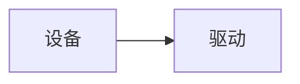
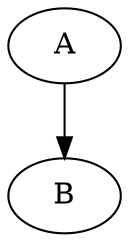
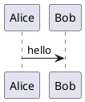

[English](visual_code_blocks.en.md)

# 图形代码块

在 Markdown 围栏第一行写下语言名，即可使用对应的本地渲染器。渲染库随安装包提供，不连接在线绘图服务。正文保留原生编辑与撤销；“源码”切换源码显示，“复制代码”复制原文，“运行 / 刷新”重建当前图形。能产生 SVG 的图形支持放大和导出 SVG，导出读取操作时的图形快照。

静态格式自动绘制。`html` 只呈现静态 HTML/CSS；需要脚本使用 `html-live`。`html-live`、`javascript-live`、`jsx`、`tsx`、`react` 点击“运行 / 刷新”后执行。普通 `js`、`javascript`、`ts` 仍是代码示例，不自动执行。JS 演示中 `root` 是绘图容器；React 导出默认组件或定义 `App`。

Vega、Vega-Lite、ECharts 使用 JSON/JSON5 配置；WaveDrom 使用 WaveJSON/JSON5。React 随包提供 React、react-dom/client 和 JSX runtime，不自动安装任意 npm 包。图表中外部数据、远程字体/图片、PlantUML 外部 include 或未随包附带的图标库不会自动下载；需要内嵌数据或已支持的图形元素。SVG 首批为静态图形，不执行脚本或 foreignObject。

正文原生 Mermaid、flow、sequence 保留宿主渲染器；Mermaid 只读预览优先复用宿主库，无法解析时尝试随包 Mermaid。每个库遵循其自己的语法和版本，并非所有第三方扩展均受支持。行内 `$...$` 和独立 `$$` 公式在搜索/链接/Git 阅读中由本地 KaTeX 呈现，原生正文与非活动分栏继续使用宿主数学能力。

交互运行在无同源权限的 iframe 内，不提供 Node、宿主 DOM 或文件接口，资源请求由 CSP 限制。iframe 不是独立操作系统进程，不能保证终止任意死循环。错误保留源码；切换/关闭清理渲染视图。长文中正文图形按可见性加载，重新进入可见区域会重建交互实例，交互临时状态不会写回 Markdown。

以下示例可直接复制到笔记中。屏幕呈现与逐图 SVG 导出是当前交付范围；Typora 整篇 HTML/PDF 导出不会自动把全部新增围栏替换为图形，分享时可先导出 SVG 再作为图片引用。其他平台和完整物理键盘/滚轮、长时压力验收见交付记录，不能用本文样例替代实测。

## 自由布局矢量图

```svg
<svg xmlns="http://www.w3.org/2000/svg" viewBox="0 0 240 80"><rect width="240" height="80" fill="lightblue"/><text x="10" y="40">架构 SVG</text></svg>
```

## 静态 HTML/CSS

```html
<style>.card{color:red;padding:12px}</style><div class="card">HTML 组成</div>
```

## 流程与结构图



## 自动布局依赖图



## 数字时序

```wavedrom
{signal:[{name:'clk',wave:'p.....'},{name:'data',wave:'x.345x',data:['A','B','C']}]}
```

## 数据图

```vega
{"$schema":"https://vega.github.io/schema/vega/v6.json","width":200,"height":100,"data":[{"name":"table","values":[{"x":10,"y":20}]}],"marks":[{"type":"rect","from":{"data":"table"},"encode":{"enter":{"x":{"field":"x"},"y":{"field":"y"},"width":{"value":80},"height":{"value":40},"fill":{"value":"steelblue"}}}}]}
```

## 声明式统计图

```vega-lite
{"data":{"values":[{"a":"A","b":3},{"a":"B","b":5}]},"mark":"bar","encoding":{"x":{"field":"a","type":"nominal"},"y":{"field":"b","type":"quantitative"}}}
```

## 交互统计图

```echarts
{"animation":false,"xAxis":{"data":["A","B"]},"yAxis":{},"series":[{"type":"bar","data":[2,3]}]}
```

## UML 时序



## 数学公式

```math
E=mc^2
```

## 传统流程图

```flow
st=>start: Start
e=>end: End
st->e
```

## 传统时序图

```sequence
Alice->Bob: hello
```

## React 交互组件

```tsx
import React, {useState} from "react"; export default function App(){const [n,set_n]=useState(0);return <button onClick={()=>set_n(n+1)}>Count {n}</button>}
```

## HTML 脚本交互

```html-live
<button id="count">0</button><script>document.getElementById("count").onclick=e=>e.target.textContent=Number(e.target.textContent)+1;</script>
```

## 显式 JavaScript 演示

```javascript-live
const button = document.createElement('button');
button.textContent = 'Click';
button.onclick = () => button.textContent = 'Done';
root.append(button);
```
